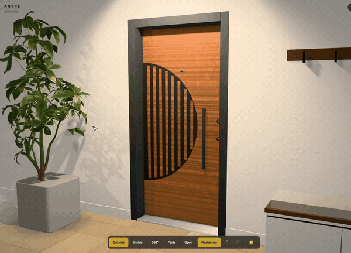
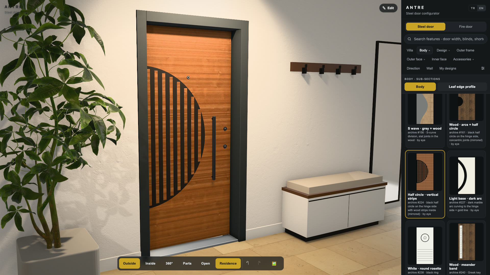
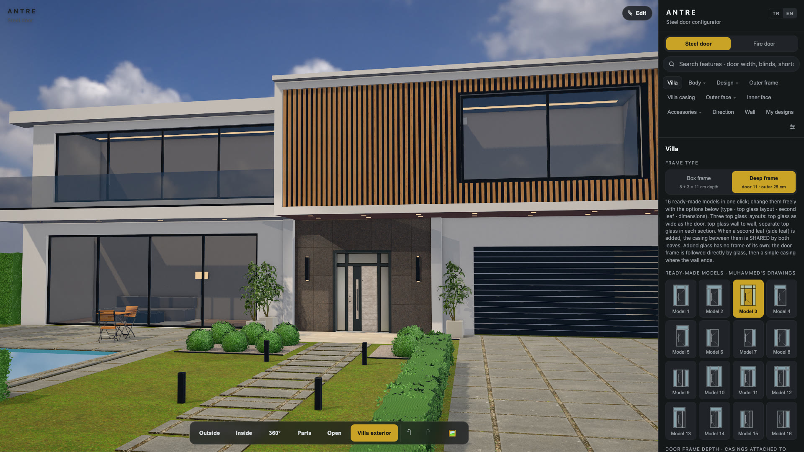
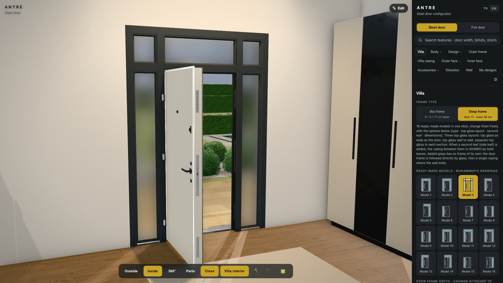
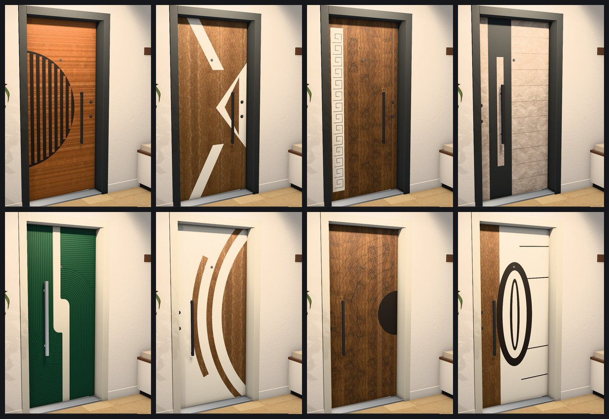

# ANTRE — Steel Door Configurator

A real-time 3D configurator for steel entrance doors and fire doors. A salesperson opens it on a tablet in the customer's home, designs the door with the customer, and shows it in the customer's own kind of entrance: an apartment landing, a residence hallway or a villa.

*antre* is Turkish for "entrance hall".

**Demo video (38 s):** [media/antre_demo.mp4](media/antre_demo.mp4)

> This is a showcase repository. ANTRE is built for a family steel door business, so its source code is private. This page shows what it does and how it is built.

## What it does

- **151 door body models**, modelled to scale from real doors in the company archive. Each one can be changed part by part: bands, strips, grooves, inlays.
- **Real decor charts** from suppliers (wood veneers, laminates, stone, RAL powder coats), applied at real scale. Wood grain is split into veneer-sized leaves so it never repeats visibly.
- **Steel door and fire door** as separate products. The fire door has a panic bar, its own hardware set and an exit sign.
- **Scenes on both sides of the door:**
  - an apartment landing with a lift and neighbours' doors;
  - a residence hallway or a store showroom;
  - a villa entrance with garden and pool, plus the villa interior behind the door.
- **16 ready-made villa entrance models:** side glass, top glass and a second leaf in different layouts.
- **Opens like a real door.** Walk around it, look from inside or outside, open it and see what is behind.
- **Design editor.** Add, move, rotate and resize parts on the door face. Includes a shape gallery and undo/redo.
- **Image export.** PNG/JPG from the browser, with an optional ray-traced mode for product-photo quality.
- **Works offline** as an installable web app (PWA). Designs are saved on the device.
- **English and Turkish** interface.
- **Experimental AR mode:** place the door on a real wall with the device camera.

## Screenshots

| | |
|---|---|
|  |  |
| A door in the residence hallway | Villa entrance with a stone-faced door |
|  |  |
| Inside the villa, door open to the garden | A few of the 151 body models |

## How it is built

| Part | Technology |
|---|---|
| 3D rendering | three.js (WebGL 2), physically based materials, HDRI lighting |
| Textures | KTX2 / Basis compressed, so the full decor library fits on a tablet |
| Baked lighting | Ambient occlusion for frame, rebate and threshold, baked in Blender Cycles |
| Image export | Supersampled accumulation, plus a ray-traced mode |
| Storage and offline | IndexedDB for designs, a service worker for the offline copy |
| Asset pipeline | Python tools that turn door photos and supplier charts into textures, measurements and models |

## Author

Muhammed Ökmen · [github.com/okmen1306](https://github.com/okmen1306) · okmen1306@gmail.com

Screenshots and video © 2026 Muhammed Ökmen. All rights reserved.
